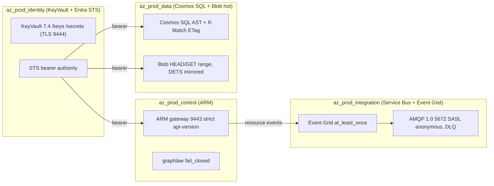
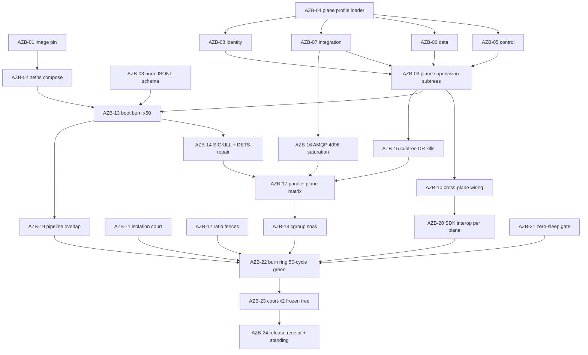

# AZSIM-BURN — v26.10.18 Sovereign Burn-In & Chaos Matrix (Azure enterprise sim)

Status: SPECIFICATION · Standing of every ticket: UNKNOWN until its receipt lands.
Base subject at authoring: `21f58b0` (main). Tickets: [`TICKETS.md`](TICKETS.md).
Receipts: `docs/jira/v26.10.18/burn/` (JSONL, schema AZB-03) +
`docs/jira/v26.10.18/receipts/azb-NN-*.md` (standing lines, real output embedded).

## Intent

v26.10.17 proved per-test isolation (2655/0) but left ~1 timing flake per
full-suite pass under host constraints. v26.10.18 moves reliability proof off the
host into a containerized burn foundry (`docker/burn/`) and models a realistic
multi-tier Azure enterprise as four concurrent **plane profiles** (`config/env/`)
inside the BEAM. No `kind`, no `act`, no cloud egress. No sleeps (NO-SLEEP-DOCTRINE).

## Fence (existing system — preserve, extend, do not replace)

| Existing | Locus | Rule for this epic |
|---|---|---|
| Single all-planes child list | `lib/smalt/application.ex` | `:plane` unset ⇒ `:all` ⇒ byte-identical child list to today |
| Flat port keys `:arm_port` / `:egress_port` / `:mcp_port` / `:arm_tls_port` | `config/config.exs`, `Smalt.Config` (ontology projection `smalt:ck-arm-port`) | Plane profiles set the **existing** keys; new keys go ontology → ggen → `Smalt.Config`, never hand-edited projection |
| Config-time ephemeral ports under `MIX_ENV=test` | `config/test.exs` | Untouched; burn containers rely on netns, test tier relies on this |
| Burn scripts (boot/chaos/soak/matrix/container) | `docker/burn/*.sh`, `compose.burn.yml`, `justfile.d/30-burn.just` | Extend; JSONL rows conform to AZB-03 schema |
| assert_eventually / Notifier / Sweeper one-writer | `rewrite-drafts/assert-eventually.ex.md`, `LRO.Notifier` | All waits route here; zero `Process.sleep` |
| court-x2 | `justfile.d/07-court-x2.just` | Final gate; burn receipts become a precondition, not a substitute |

## Plane topology

Two deployment shapes, same profiles:
1. **Single node, all planes** (`SMALT_PLANES=control,data,integration,identity`): one BEAM, four isolated supervision subtrees.
2. **Plane-per-container** (burn matrix): one netns per plane, canonical ports (9443/8443/5672) with zero collision.

## Ticket DAG

## Release gate (v26.10.18)

| # | Invariant | Machine check | Ticket |
|---|---|---|---|
| G1 | 0 unclassified `Process.sleep` in `lib/` + `test/` | `just sleep-gate` exit 0 + seeded-sleep mutation refused | AZB-21 |
| G2 | Burn matrix 4 planes × N containers × 50 cycles: 0 orphans, 0 unhandled exceptions, 100% receipts | `just burn-ring` + `validate_burn.py --gate` | AZB-22 |
| G3 | court-x2 two consecutive green on frozen quiescent tree | `just court-x2` judge log | AZB-23 |
| G4 | Isolation court: 0 unguarded `Application.put_env`, 0 unsupervised singletons | `just isolation-court` | AZB-11 |
| G5 | Every unmodified SDK lane green against its plane profile | `just azsim-sdk` | AZB-20 |

Close condition: honest all-green or honest typed RED (`broken_term` from the
Chatman table). Never a faked pass; a single burn row missing ⇒ `R_missing_consequence`.
